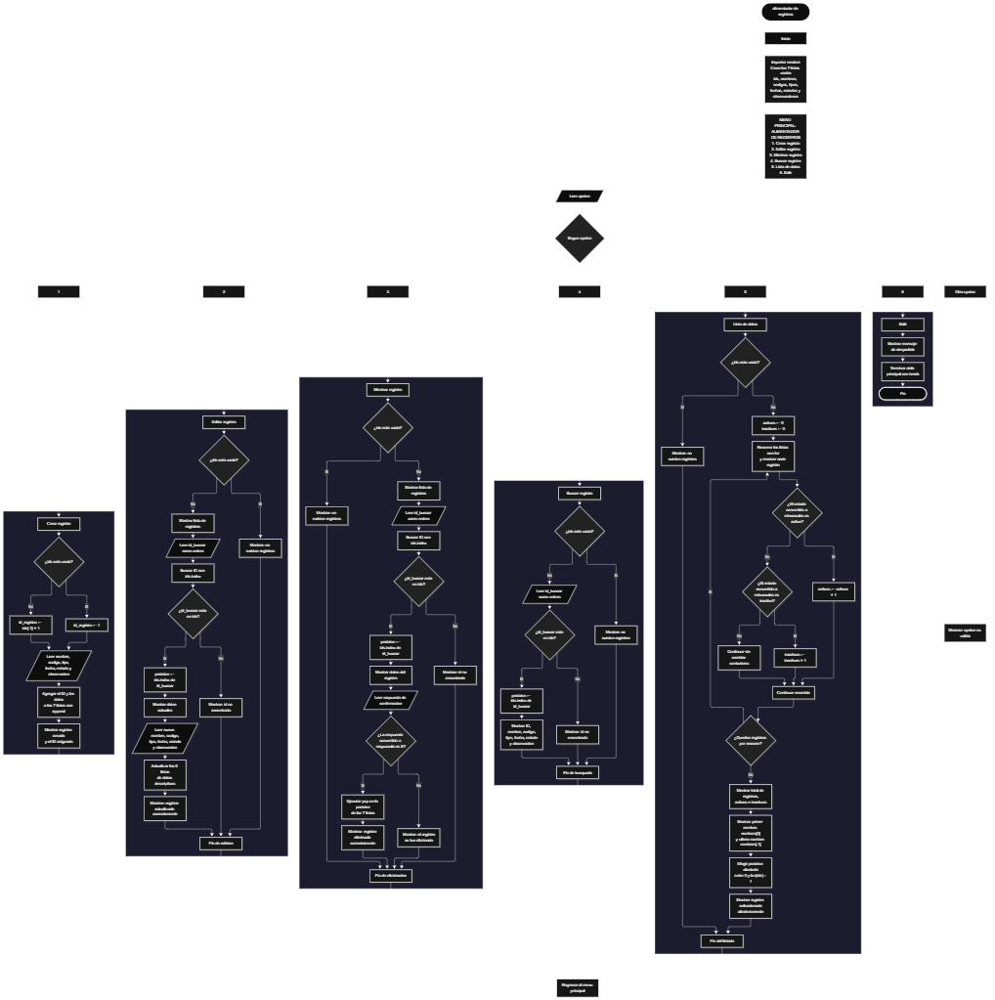

 

Este proyecto, llamado <b>alimentador de registros</b>, fue desarrollado en <b>python</b> como un ejercicio práctico para fortalecer la lógica de programación mediante la creación de un sistema de gestión de registros desde la consola. El programa cuenta con un menú principal de seis opciones que permite <b>crear, editar, eliminar, buscar y listar registros</b>, además de finalizar la ejecución del sistema. Cada registro almacena información como el nombre, el código, el tipo, la fecha, el estado y las observaciones, utilizando siete listas paralelas que mantienen relacionados los datos mediante sus posiciones. Durante su desarrollo se aplicaron conceptos fundamentales de programación, como variables, listas, estructuras condicionales, ciclos repetitivos, manipulación de datos y operaciones de búsqueda, modificación y eliminación. Asimismo, se implementaron contadores para obtener estadísticas de los registros activos e inactivos y una simulación que selecciona aleatoriamente uno de los registros existentes. Este proyecto permite poner en práctica los conocimientos adquiridos en python y sirve como base para desarrollar sistemas de gestión más avanzados utilizando otros lenguajes y tecnologías.

<h2 align="center">⚙️ Funcionamiento del menú principal</h2>

### ➕ Crear registro

La opción <b>1) crear registro</b> permite registrar un nuevo elemento en el sistema. Antes de solicitar los datos, el programa comprueba si la lista <b>ids</b> está vacía mediante la condición <b>len(ids) == 0</b>. Si no existen registros, asigna el identificador inicial <b>1</b> a la variable <b>id_registro</b>. En caso contrario, obtiene el último identificador almacenado mediante <b>ids[-1]</b> y le suma uno para calcular el siguiente ID. Después, solicita el <b>nombre, código, tipo de registro, fecha, estado y observación</b>. Los datos se incorporan a sus respectivas listas mediante el método <b>append()</b>, conservando la correspondencia entre las posiciones de las siete listas. Finalmente, muestra el mensaje <b>"registro creado correctamente."</b> y presenta el identificador asignado. El programa no establece una capacidad máxima de registros ni valida que los campos introducidos estén completos.

### ✏️ Editar registro

La opción <b>2) editar registro</b> permite modificar la información de un registro existente. Primero, el programa comprueba si la lista <b>ids</b> está vacía. Si no hay registros, muestra el mensaje <b>"no existen registros."</b>. En caso contrario, utiliza un ciclo <b>for</b> para recorrer las posiciones de las listas y mostrar todos los registros almacenados. Después, solicita el identificador mediante la variable <b>id_buscar</b>, convirtiendo la entrada a un número entero con <b>int()</b>. El programa comprueba si el identificador se encuentra en <b>ids</b> mediante la condición <b>id_buscar in ids</b>. Si existe, utiliza <b>ids.index(id_buscar)</b> para obtener la posición correspondiente y mostrar los datos actuales. A continuación, solicita el nuevo nombre, código, tipo de registro, fecha, estado y observación, actualizando directamente los valores de las seis listas descriptivas. El identificador original se conserva. Finalmente, presenta el mensaje <b>"registro actualizado correctamente."</b>. Si el ID no existe, muestra el mensaje <b>"id no encontrada."</b>.

### 🗑️ Eliminar registro

La opción <b>3) eliminar registro</b> permite eliminar un registro almacenado en el sistema. Primero, comprueba si existen registros en la lista <b>ids</b>. Si está vacía, muestra el mensaje <b>"no existen registros."</b>. Si hay datos disponibles, recorre las listas mediante un ciclo <b>for</b> y muestra la información de cada registro. Después, solicita el ID que se desea eliminar y comprueba si está presente en <b>ids</b>. Si lo encuentra, obtiene su posición con <b>ids.index(id_buscar)</b> y muestra todos los datos del registro seleccionado. A continuación, solicita confirmación mediante la variable <b>respuesta</b>. Si la respuesta convertida a mayúsculas con <b>upper()</b> es igual a <b>"S"</b>, ejecuta el método <b>pop(posicion)</b> en las siete listas para eliminar los datos correspondientes. De esta manera, se conserva la relación entre los campos restantes. Finalmente, muestra el mensaje <b>"registro eliminado correctamente."</b>. Si el usuario no confirma la operación, presenta <b>"el registro no fue eliminado."</b>. Si el ID no existe, informa que no fue encontrado.

### 🔎 Buscar registro

La opción <b>4) buscar registro</b> permite localizar un registro utilizando su identificador. Antes de iniciar la búsqueda, el programa comprueba si existen registros almacenados. Si la lista <b>ids</b> está vacía, muestra el mensaje <b>"no existen registros."</b>. En caso contrario, solicita el ID mediante la variable <b>id_buscar</b> y lo convierte a un número entero con <b>int()</b>. Después, comprueba si el identificador se encuentra en la lista <b>ids</b>. Si existe, utiliza <b>ids.index(id_buscar)</b> para encontrar la posición del registro y mostrar toda su información: <b>id, nombre, código, tipo, fecha, estado y observación</b>. Si no encuentra el identificador, muestra el mensaje <b>"id no encontrada."</b>. Esta operación permite consultar un registro específico sin necesidad de modificar los datos almacenados.

### 📋 Lista de datos

La opción <b>5) lista de datos</b> permite visualizar los registros almacenados y obtener estadísticas generales del sistema. Primero, comprueba si existen registros en la lista <b>ids</b>. Si no hay datos, muestra el mensaje <b>"no existen registros."</b>. Si existen registros, inicializa los contadores <b>activos</b> e <b>inactivos</b> en cero y utiliza un ciclo <b>for</b> para recorrer las posiciones de las siete listas. Durante el recorrido, muestra la información de cada registro y comprueba su estado mediante las condiciones <b>estados[i].lower() == "activo"</b> y <b>estados[i].lower() == "inactivo"</b>. Cuando encuentra uno de estos estados, incrementa el contador correspondiente en uno. Al finalizar, presenta la cantidad total de registros, el número de registros activos e inactivos, el primer nombre almacenado mediante <b>nombres[0]</b> y el último mediante <b>nombres[-1]</b>. Posteriormente, utiliza <b>random.randint(0, len(ids) - 1)</b> para seleccionar una posición aleatoria y mostrar el registro correspondiente como parte de la simulación de alimentación. Esta simulación únicamente muestra un registro existente: no crea ni incorpora uno nuevo al sistema.

### 🚪 Salir del menú principal

La opción <b>6) salir</b> permite finalizar la ejecución del programa. Cuando el usuario selecciona esta opción, el sistema muestra el mensaje <b>"gracias por utilizar el alimentador de registros."</b> y ejecuta la instrucción <b>break</b>, que interrumpe el ciclo principal <b>while True</b>. De esta manera, el programa deja de mostrar el menú y termina su ejecución. Los registros se almacenan únicamente en las listas durante el funcionamiento del programa, por lo que la información no se conserva automáticamente cuando se cierra.

<h2 align="center">🧠 Temas aplicados en el proyecto</h2>

### 📦 Variables

En este proyecto se utilizan variables para controlar la opción seleccionada en el menú, asignar identificadores, almacenar temporalmente los datos introducidos por el usuario, localizar registros y calcular estadísticas. Cada variable cumple una función específica dentro de las operaciones de gestión, facilitando el control y la organización de la información.

🔢 **Opcion:** Almacena la opción seleccionada por el usuario en el menú principal.

🆔 **Id_registro:** Guarda el identificador que se asigna al nuevo registro.

🔎 **Id_buscar:** Almacena el identificador introducido para localizar un registro.

📍 **Posicion:** Guarda el índice correspondiente al registro encontrado dentro de las listas.

📝 **Nombre, codigo, tipo, fecha, estado y observacion:** Almacenan temporalmente los datos solicitados durante la creación de un registro.

✏️ **Respuesta:** Guarda la respuesta del usuario para confirmar o cancelar la eliminación de un registro.

📊 **Activos e inactivos:** Son contadores que almacenan la cantidad de registros cuyos estados coinciden con los valores reconocidos por el programa.

🔄 **I:** Se utiliza como índice en los ciclos que recorren y muestran los registros.

🎲 **Posicion:** También se utiliza para almacenar la posición elegida aleatoriamente durante la simulación de alimentación.

### 🗃️ Listas

En este proyecto se utilizan siete listas paralelas para almacenar la información de los registros. Cada lista contiene un campo específico y todas mantienen una correspondencia por posición. Por ejemplo, los datos de un registro situado en el índice <b>0</b> se encuentran distribuidos entre <b>ids[0], nombres[0], codigos[0], tipos[0], fechas[0], estados[0] y observaciones[0]</b>. Esta organización permite recorrer, buscar, modificar, mostrar y eliminar registros sin necesidad de utilizar una estructura de datos más compleja.

🆔 **Ids:** Almacena los identificadores de los registros.

📝 **Nombres:** Guarda los nombres de los registros.

🔢 **Codigos:** Almacena los códigos asociados a cada registro.

🗂️ **Tipos:** Guarda el tipo de registro.

📅 **Fechas:** Almacena las fechas correspondientes a los registros.

🔄 **Estados:** Guarda el estado de cada registro, como activo o inactivo.

📄 **Observaciones:** Almacena información adicional de cada registro.

### 🔀 Estructuras condicionales

En este proyecto se utilizan las estructuras <b>if, elif y else</b> para controlar las opciones del menú y decidir qué instrucciones ejecutar según los datos disponibles y las respuestas del usuario. Las condiciones permiten comprobar si existen registros, determinar el identificador que se asignará, verificar si un ID está almacenado, confirmar la eliminación y clasificar los registros según su estado. Estas estructuras permiten que el programa responda de manera diferente según cada situación.

### 🔄 Estructuras repetitivas

El programa utiliza los ciclos <b>while</b> y <b>for</b> para ejecutar las operaciones de gestión. El ciclo <b>while True</b> mantiene activo el menú principal hasta que se selecciona la opción de salida y se ejecuta <b>break</b>. Por otro lado, los ciclos <b>for</b> permiten recorrer las listas para mostrar los registros durante las operaciones de edición y eliminación, así como para listar los datos y calcular las estadísticas de los estados. Estos ciclos reducen la necesidad de repetir manualmente las mismas instrucciones para cada registro.

### 🎯 Selección de opciones

La selección de opciones se realiza mediante una estructura condicional formada por <b>if, elif y else</b>. El programa compara la variable <b>opcion</b> con los valores de texto del <b>"1"</b> al <b>"6"</b> y ejecuta la operación correspondiente. Las opciones permiten crear, editar, eliminar, buscar y listar registros, además de salir del programa. Si el valor introducido no coincide con ninguna opción disponible, se ejecuta el bloque <b>else</b> y se muestra el mensaje <b>"opción no válida."</b>.

### 🆔 Identificadores y búsqueda

El programa utiliza identificadores numéricos para distinguir los registros y facilitar su localización. Al crear un registro, calcula el siguiente ID a partir del último identificador almacenado en la lista <b>ids</b>. Para las operaciones de edición, eliminación y búsqueda, utiliza la condición <b>id_buscar in ids</b> para comprobar si el identificador existe. Después, el método <b>index()</b> permite obtener la posición correspondiente y acceder a los datos relacionados en las demás listas. Este procedimiento mantiene las operaciones vinculadas al identificador del registro, aunque los identificadores eliminados pueden volver a utilizarse si se elimina el último registro.

### 🔧 Manipulación de listas

La manipulación de listas es una parte fundamental del proyecto. El método <b>append()</b> permite agregar los datos de un nuevo registro al final de cada lista, mientras que <b>pop(posicion)</b> elimina el elemento ubicado en la posición seleccionada. Por su parte, <b>index()</b> localiza la posición de un identificador y <b>len()</b> permite conocer la cantidad de registros almacenados. También se utilizan los índices <b>[0]</b> y <b>[-1]</b> para consultar, respectivamente, el primer y el último nombre registrado. Estas operaciones permiten administrar los datos durante la ejecución del programa.

### 📊 Estadísticas y contadores

El sistema incorpora estadísticas en la opción <b>lista de datos</b>. Para calcularlas, inicializa las variables <b>activos</b> e <b>inactivos</b> en cero y recorre los registros almacenados. Mediante el método <b>lower()</b>, convierte temporalmente el texto del estado a minúsculas antes de compararlo con los valores <b>"activo"</b> e <b>"inactivo"</b>. Cuando encuentra una coincidencia, incrementa el contador correspondiente. Al terminar el recorrido, muestra la cantidad total de registros y los resultados de ambos contadores. Los estados diferentes de los dos valores reconocidos no se contabilizan como activos ni como inactivos.

### 🎲 Selección aleatoria

El módulo <b>random</b> se importa al inicio del programa y se utiliza durante la opción <b>lista de datos</b>. La función <b>random.randint(0, len(ids) - 1)</b> genera un número entero aleatorio comprendido entre cero y el índice del último registro. El resultado se almacena en la variable <b>posicion</b> y permite mostrar los datos del registro seleccionado. Como el programa comprueba previamente que existan registros, la selección aleatoria se realiza cuando las listas contienen información. Este procedimiento simula la alimentación de registros, pero no modifica ni incrementa la cantidad de elementos almacenados.

### 🔤 Cadenas de texto y f-strings

El programa utiliza cadenas de texto para solicitar datos, mostrar mensajes y presentar los registros. Las <b>f-strings</b> permiten insertar directamente los valores de las listas dentro de una cadena, facilitando la presentación de los campos separados por el símbolo <b>|</b>. Además, los métodos <b>upper()</b> y <b>lower()</b> permiten convertir temporalmente las respuestas a mayúsculas o minúsculas para realizar comparaciones. Esto se utiliza para confirmar la eliminación y para contar los registros activos e inactivos sin distinguir entre mayúsculas y minúsculas.

<h2 align="center">¿Cómo se implementaron las operaciones crud en el proyecto?</h2>

Las operaciones <b>crud</b> se implementaron mediante las opciones del menú principal para administrar los registros almacenados. La operación <b>crear</b> corresponde a <b>crear registro</b>, donde se solicitan los datos y se agregan a las siete listas mediante <b>append()</b>. La operación <b>leer</b> se realiza mediante <b>buscar registro</b> y <b>lista de datos</b>, que permiten consultar un registro específico o visualizar todos los registros y sus estadísticas. La operación <b>actualizar</b> corresponde a <b>editar registro</b>, donde se localiza un ID y se modifican los campos descriptivos. Por último, la operación <b>eliminar</b> corresponde a <b>eliminar registro</b>, que solicita confirmación y utiliza <b>pop()</b> para retirar los datos de las siete listas en la posición correspondiente. Estas operaciones permiten gestionar la información temporalmente durante la ejecución del programa, sin utilizar una base de datos ni guardar los registros en archivos.

<h2 align="center">Diagrama de flujo del proyecto</h2>

<h2 align="center">🛡️ Validaciones del programa</h2>

### 📭 No existen registros

Esta comprobación se utiliza en las opciones de <b>editar, eliminar, buscar y lista de datos</b>. El programa verifica si la lista <b>ids</b> está vacía mediante la condición <b>len(ids) == 0</b>. Si no existen registros, muestra el mensaje <b>"no existen registros."</b> y evita continuar con las operaciones que necesitan información almacenada. Esta comprobación también impide que la opción de listado intente seleccionar aleatoriamente un registro cuando las listas están vacías.

### ❌ Identificador no encontrado

Esta validación se utiliza durante las operaciones de edición, eliminación y búsqueda. El programa comprueba si el valor de <b>id_buscar</b> se encuentra en la lista <b>ids</b>. Si existe, obtiene su posición mediante <b>ids.index(id_buscar)</b> y continúa con la operación correspondiente. Si no encuentra el identificador, muestra el mensaje <b>"id no encontrada."</b>. Esta comprobación permite evitar el acceso a una posición mediante un ID que no se encuentra registrado en la lista.

### ⚠️ Confirmación de eliminación

Antes de eliminar un registro, el programa muestra sus datos y solicita una respuesta mediante la pregunta <b>"¿desea eliminar este registro? (s/n): "</b>. Después, utiliza <b>respuesta.upper() == "S"</b> para comprobar si el usuario confirmó la operación con la letra <b>s</b> o <b>S</b>. Si la respuesta coincide, elimina los datos de las siete listas utilizando <b>pop(posicion)</b>. En caso contrario, muestra el mensaje <b>"el registro no fue eliminado."</b> y conserva la información almacenada.

### 🔄 Clasificación de estados

Durante la opción <b>lista de datos</b>, el programa clasifica los registros según el contenido de la lista <b>estados</b>. Para reconocer los valores <b>"activo"</b> e <b>"inactivo"</b>, utiliza el método <b>lower()</b> antes de compararlos. De esta manera, también reconoce entradas como <b>"ACTIVO"</b> o <b>"Inactivo"</b>. Sin embargo, no comprueba que el usuario introduzca exclusivamente esos dos estados al crear o editar un registro. Si el valor almacenado es diferente, no incrementa ninguno de los dos contadores.

### ⚠️ Opción no válida

El bloque <b>else</b> de la estructura condicional del menú se ejecuta cuando el usuario introduce un valor que no coincide con las opciones disponibles. En ese caso, muestra el mensaje <b>"opción no válida."</b>. Después, el ciclo principal continúa y vuelve a presentar el menú, permitiendo que el usuario seleccione otra opción. La comprobación no valida que la entrada tenga un formato específico antes de compararla con las opciones del menú.

### 🔢 Conversión del identificador

Durante las operaciones de edición, eliminación y búsqueda, el programa utiliza <b>int(input(...))</b> para convertir el identificador introducido a un número entero. Esta conversión permite comparar el valor con los identificadores numéricos almacenados en la lista <b>ids</b>. Sin embargo, el programa no incluye un manejo de excepciones para entradas que no puedan convertirse a un entero. Por ello, si el usuario introduce texto no numérico u otro valor incompatible, puede producirse un error que interrumpa la ejecución.

### 🆔 Asignación de identificadores

Al crear un registro, el programa asigna el ID inicial <b>1</b> cuando la lista <b>ids</b> está vacía. Si existen registros, calcula el siguiente identificador sumando uno al último valor almacenado mediante <b>ids[-1] + 1</b>. Este procedimiento permite asignar identificadores consecutivos en el funcionamiento habitual. No obstante, si se elimina el último registro, el siguiente ID se calcula a partir del nuevo último elemento y puede reutilizar un identificador eliminado. El programa no mantiene un contador independiente para garantizar que los identificadores nunca se repitan durante la ejecución.

<h2 align="center">🎯 Objetivo del proyecto</h2>

El objetivo principal de este proyecto es fortalecer la <b>lógica de programación</b> mediante el desarrollo de un sistema de gestión de registros en <b>python</b>. A través de su construcción se busca aplicar los conocimientos adquiridos sobre variables, listas, estructuras condicionales, ciclos repetitivos, manipulación de datos, búsqueda y operaciones crud. Además, el proyecto permite comprender cómo organizar información mediante listas paralelas, mantener la correspondencia entre los campos de cada registro, calcular estadísticas básicas y utilizar la selección aleatoria para simular una operación del sistema. Este ejercicio constituye una base para desarrollar aplicaciones de gestión más completas que incorporen validaciones adicionales, almacenamiento persistente y otras funcionalidades en el futuro.

